# Codyssey Development Workstation


## 1. 사용 환경

| 항목 | 확인된 환경 |
|---|---|
| 운영체제 | Windows (Windows NT `10.0.26300.0`) |
| 편집기 | Visual Studio Code |
| 명령어 창 | Windows PowerShell `5.1.26100.9711` |
| Docker | **29.9.2**, Linux 컨테이너 |
| Linux 실습 | Docker Ubuntu 이미지 |
| 웹 서버 | `nginx:alpine` 기반 커스텀 이미지 `codyssey-web:v1` |
| Git 브랜치 | `main` |
| Git 버전 | **2.56.0.windows.4** (`git --version` 결과 사진 확인) |
| GitHub | [hyeonla906/codyssey-workstation](https://github.com/hyeonla906/codyssey-workstation) — 저장소 생성·원격 주소 설정 확인, 

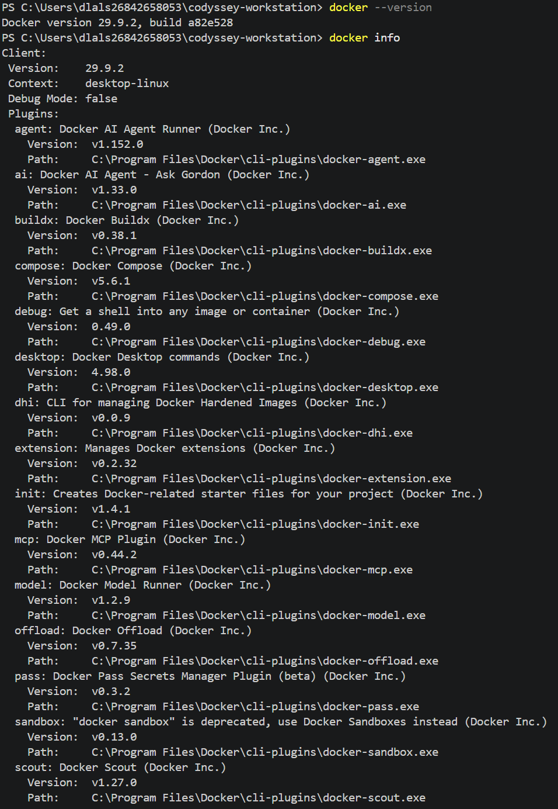

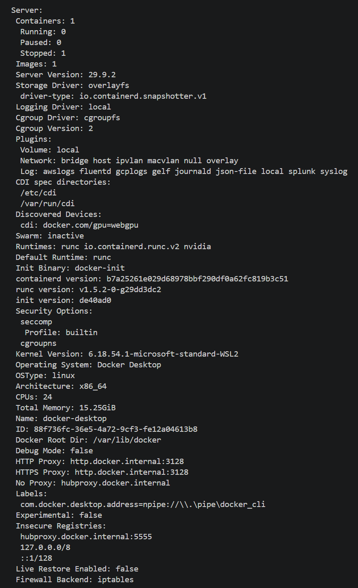

## 2. 전체 실습 현황

- [x] 터미널로 파일 만들기·복사·이동·삭제
- [x] Linux 파일 권한 `600`, `644` 확인
- [x] Linux 폴더 권한 `700` 확인
- [x] Linux 폴더 권한 `755`의 최종 출력 캡처 및 재확인
- [x] Docker 설치 및 Linux 엔진 정보 확인
- [x] `hello-world` 실행, Ubuntu 컨테이너 명령 실습
- [x] HTML과 Dockerfile 작성
- [x] 커스텀 이미지 제작 및 웹페이지 8080번 접속
- [x] 바인드 마운트 웹페이지 변경 전·후 사진 확인
- [x] 볼륨 데이터 보관 확인 (컨테이너 삭제 후 `SAVE-OK`)
- [x] 트러블슈팅 2건 및 해결 과정 정리
- [x] Git 로컬 `main` 브랜치와 GitHub 원격 저장소 주소 확인
- [x] Git 버전 `2.56.0.windows.4` 실제 출력 사진 확인
- [ ] **[추가 필요]** `git push` 성공 및 GitHub 업로드된 파일 목록 확인
- [x] 컨테이너 삭제 후 볼륨 데이터(`SAVE-OK`) 재확인 사진 확보
- [ ] **[추가 필요]** GitHub 공개 전 사진·로그 개인정보 점검

## 3. 프로젝트 폴더 및 실습


터미널로 파일 만들기·복사·이동·삭제 방법 

### 주요 명령어

```powershell
pwd
Get-ChildItem -Force
mkdir practice\lesson1
cd practice\lesson1
New-Item empty.txt -ItemType File
"Hello Codyssey" | Set-Content hello.txt
Get-Content hello.txt
Copy-Item hello.txt copy.txt
Rename-Item copy.txt renamed.txt
mkdir backup
Move-Item renamed.txt backup
Get-ChildItem backup
Remove-Item backup\renamed.txt
Get-ChildItem backup
cd ..\..
```

### 실제 확인한 결과

`hello.txt`에서 `Hello Codyssey`가 출력되었다. `renamed.txt`가 `backup` 폴더로 이동한 뒤 파일 목록에 보였고, 삭제 후 목록이 비어 있음을 확인했다.

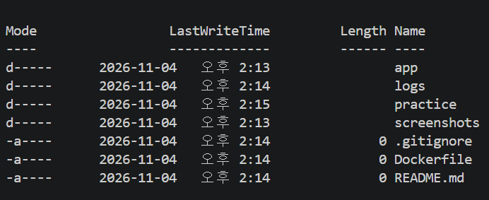

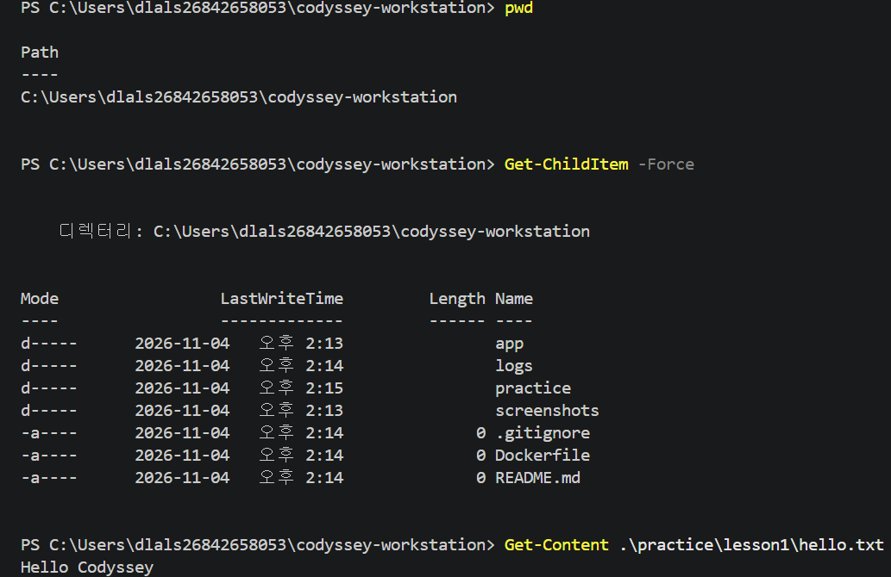

[터미널 실습 로그](logs/verified/01-terminal.txt)


## 4. Linux 파일과 폴더 권한

### 목적

Ubuntu 컨테이너 안에서 파일 1개와 폴더 1개의 사용 권한을 확인하고 바꾸는 방법을 연습했다.

| 숫자 | 뜻 | 실제 증거 |
|---|---|---|
| `600` | 주인만 읽고 쓰기 (`-rw-------`) | 사진에서 확인 |
| `644` | 주인은 읽고 쓰기, 그 외는 읽기 (`-rw-r--r--`) | 사진에서 확인 |
| `700` | 폴더 주인만 사용·진입 (`drwx------`) | 사진에서 확인 |
| `755` | 주인은 모든 권한, 그 외는 읽기·진입 (`drwxr-xr-x`) | **확인 완료:** 추가 사진에서 변경 명령과 `ls -ld /testdir` 출력 확인 |

### 실행 명령

```powershell
docker run -d --name permission-lab ubuntu sleep infinity
docker exec permission-lab touch /test.txt
docker exec permission-lab ls -l /test.txt
docker exec permission-lab chmod 600 /test.txt
docker exec permission-lab ls -l /test.txt
docker exec permission-lab chmod 644 /test.txt
docker exec permission-lab ls -l /test.txt
docker exec permission-lab mkdir /testdir
docker exec permission-lab chmod 700 /testdir
docker exec permission-lab ls -ld /testdir
docker exec permission-lab chmod 755 /testdir
docker exec permission-lab ls -ld /testdir
```

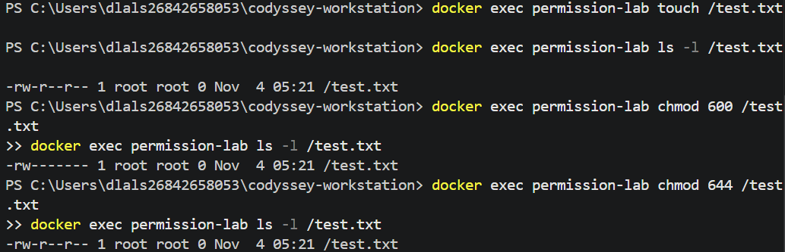

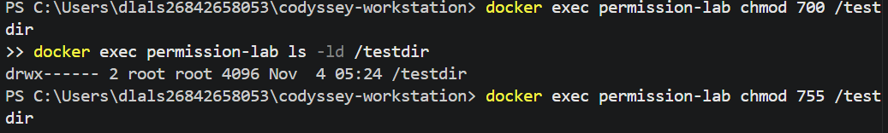

### 추가 검증 — 폴더 권한 `755` 확인 (2026-11-04)

기존 `permission-lab` 컨테이너에서 아래 명령어를 실행해 폴더 권한을 다시 확인.

```powershell
docker exec permission-lab chmod 755 /testdir
docker exec permission-lab ls -ld /testdir
```

**실제 화면에서 확인한 출력:**

```text
drwxr-xr-x 2 root root 4096 Nov  4 05:24 /testdir
```

출력 맨 앞의 **`drwxr-xr-x`는 755 권한**을 뜻하므로, 폴더 권한 `755` 변경 및 확인을 완료했다.

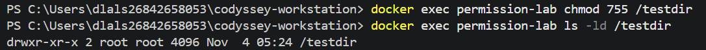

[최초 권한 실습 로그](logs/verified/02-permissions.txt)


## 5. Docker 기본 점검과 컨테이너 운영

### Docker 버전 및 엔진 확인

```powershell
docker --version
docker info
```

화면에서 **Docker 29.9.2**와 Linux 엔진(`OSType: linux`)을 확인했다.

[Docker 환경 확인 로그](logs/verified/03-docker.txt) (원본 PowerShell 기록에는 일부 출력이 없으므로 위 사진을 함께 참고)

### 이미지와 컨테이너 실행

```powershell
docker pull ubuntu
docker run hello-world
docker run -it --name ubuntu-practice ubuntu bash
docker images
docker ps
docker ps -a
docker run -d --name ubuntu-running ubuntu sleep infinity
docker exec ubuntu-running echo Hello-from-exec
docker stop ubuntu-running
docker start ubuntu-running
docker logs ubuntu-running
docker stats --no-stream
```

- `docker run hello-world` 실행에서 **`Hello from Docker!`**가 출력되었다.
- Ubuntu 안에서 `pwd`, `ls`, `echo Hello-Codyssey` 명령이 실행되어 `Hello-Codyssey`가 출력되었다.
- 실행 중인 컨테이너에 `docker exec`를 사용했으며, 중지·재시작·자원 사용량 확인을 수행했다.

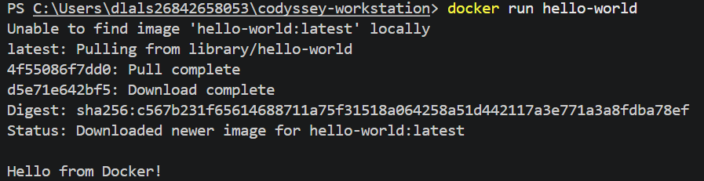

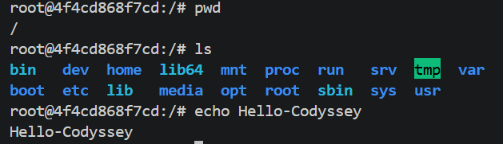

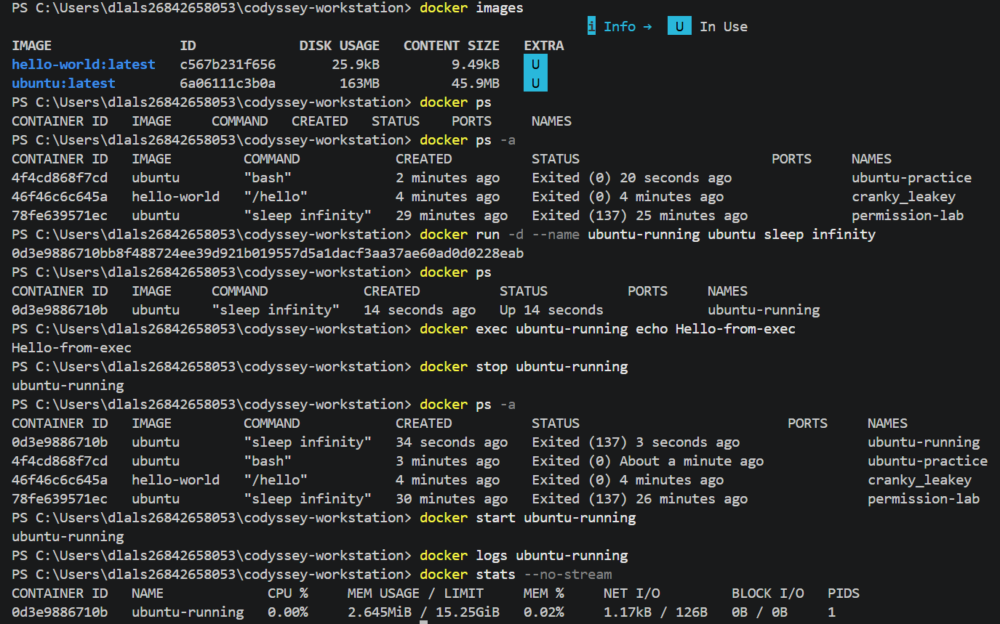

[컨테이너 실습 로그](logs/verified/04-containers.txt)

## 6. HTML 및 Dockerfile 제작

### HTML

`app/index.html`에 한국어 제목과 웹 서버 실행 문구가 있는 페이지를 작성했다.

```html
<h1>안녕하세요! 코디세이입니다.</h1>
<p>Docker 웹 서버 실행 성공!</p>
<p>내가 만든 첫 번째 웹사이트</p>
```

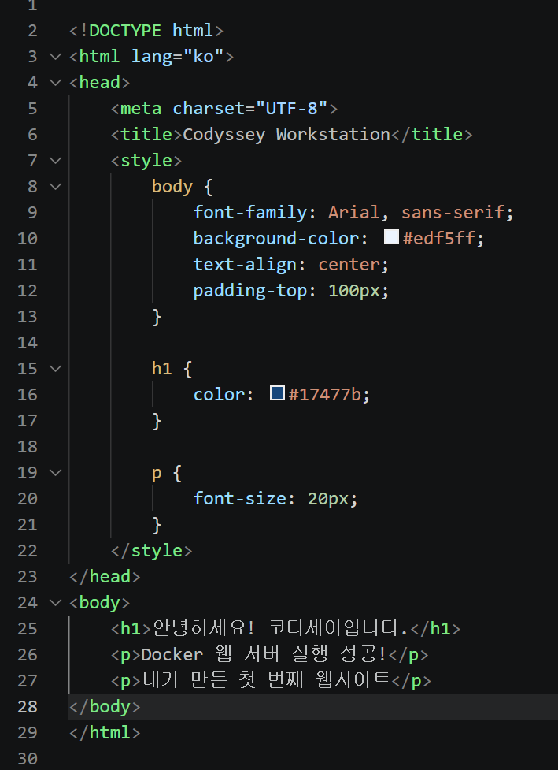

### Dockerfile

```dockerfile
FROM nginx:alpine
COPY app/index.html /usr/share/nginx/html/index.html
EXPOSE 80
```

- `FROM`: NGINX를 기본 웹 서버로 선택
- `COPY`: 직접 만든 HTML을 웹 서버 내부로 복사
- `EXPOSE`: 내부 80번 포트를 사용한다는 정보 기록

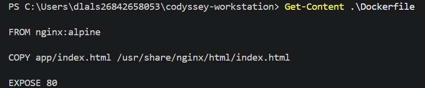

[파일 작성 및 내용 확인 로그](logs/verified/05-files.txt)

## 7. Docker 이미지 빌드와 웹 서버 접속

### 실행 명령

```powershell
docker build -t codyssey-web:v1 .
docker images
docker run -d --name codyssey-web -p 8080:80 codyssey-web:v1
curl.exe http://localhost:8080
docker ps
docker logs codyssey-web
docker stats --no-stream
```

### 확인 결과

- `docker build`에서 `COPY app/index.html` 단계와 `codyssey-web:v1` 이미지 생성 완료를 확인했다.
- `docker ps`에서 `codyssey-web`이 실행 중(`Up`)이고 `8080->80/tcp`로 연결된 것을 확인했다.
- 브라우저에서 **`http://localhost:8080`**에 접속하여 직접 작성한 한국어 페이지를 확인했다.
- NGINX 로그에서 `GET /`에 대한 **HTTP 200** 응답을 확인했다.
- `favicon.ico` 요청의 404가 별도로 기록되어 있으나 기본 웹페이지의 성공과는 다른 요청이다.

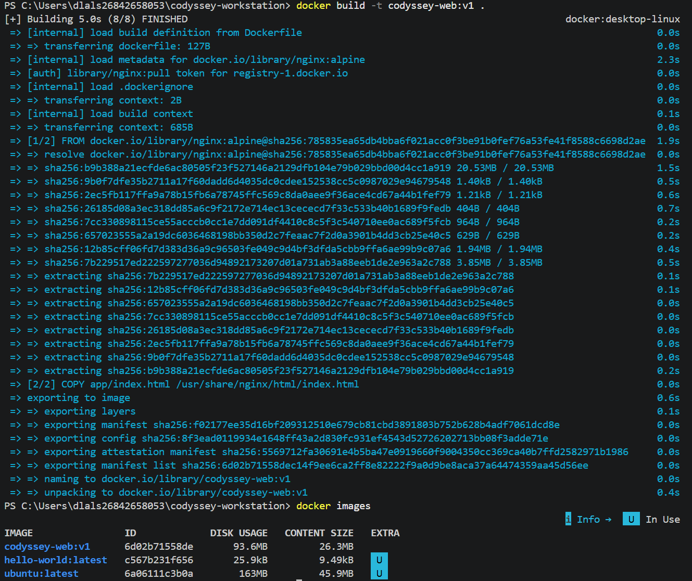

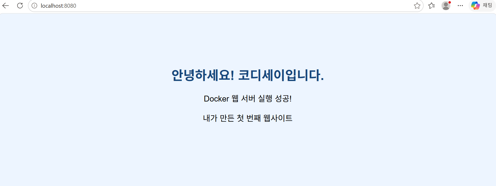

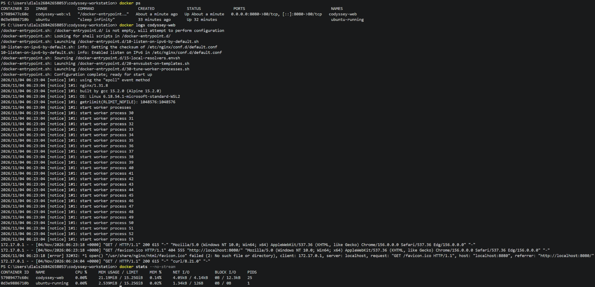

[웹 서버 실습 로그](logs/verified/06-webserver.txt)

## 8. 바인드 마운트 — 웹페이지 변경 전후 비교

### 목적

컴퓨터의 `app` 폴더와 NGINX 컨테이너의 웹 폴더를 연결한 뒤 HTML 수정이 화면에 반영되는지 확인했다.

### 실행 명령

```powershell
$appPath = (Resolve-Path .\app).Path
docker run -d --name codyssey-bind -p 8081:80 --mount "type=bind,source=$appPath,target=/usr/share/nginx/html,readonly" codyssey-web:v1
curl.exe http://localhost:8081
Copy-Item .\app\index.html .\practice\index-backup.html
Select-String -Path .\app\index.html -Pattern "바인드 마운트 변경 성공!"
curl.exe http://localhost:8081
docker inspect codyssey-bind --format '{{json .Mounts}}'
Copy-Item .\practice\index-backup.html .\app\index.html -Force
```

### 확인 결과

`localhost:8081`을 사용하는 웹페이지와 VS Code 코드를 나란히 촬영했다. 사진에서 표시 문구가 **`바운드 실행 성공! 이전` → `바운드 실행 성공! 이후`**로 변경된 것을 확인했다.

로그에는 별도로 `바인드 마운트 변경 성공!` 문구가 HTML 파일에서 검색된 기록이 있다. 이는 사진 촬영 당시의 문구와 다른 시점의 기록이므로 두 자료를 구분해서 설명한다.

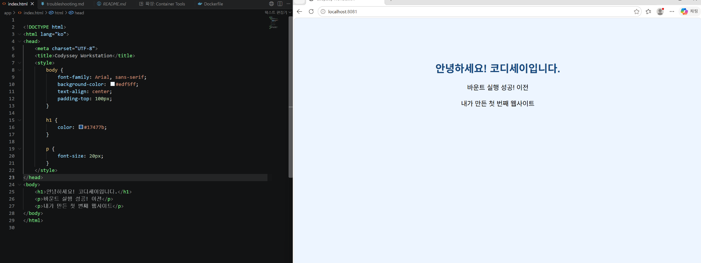

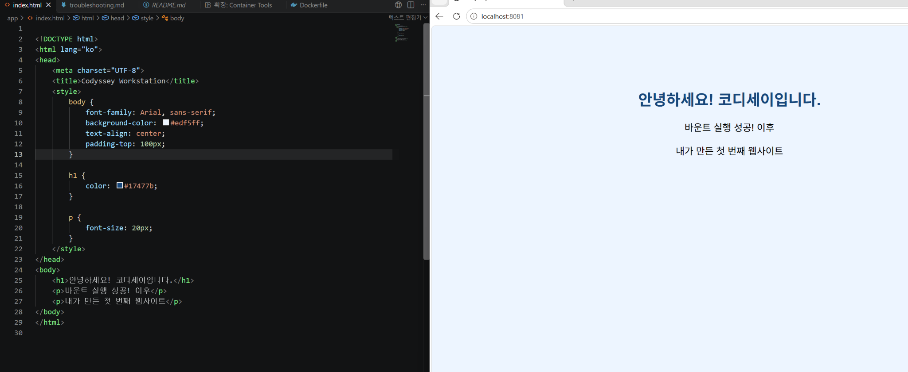

[바인드 마운트 실습 로그](logs/verified/07-bind.txt)


## 9. Docker 볼륨 — 컨테이너 삭제 후 데이터 유지

### 실행 명령

```powershell
docker volume create codyssey-data
docker volume ls
docker run -d --name volume-first --mount type=volume,source=codyssey-data,target=/data ubuntu sleep infinity
docker exec volume-first sh -c "echo SAVE-OK > /data/check.txt"
docker exec volume-first cat /data/check.txt
docker stop volume-first
docker rm volume-first
docker run --rm --mount type=volume,source=codyssey-data,target=/data ubuntu cat /data/check.txt
docker volume inspect codyssey-data
```

### 확인 결과

첫 번째 컨테이너에서 `/data/check.txt`를 읽었을 때 **`SAVE-OK`**가 출력됐다. 이후 `volume-first`를 중지·삭제하고 다른 컨테이너에서 같은 볼륨을 읽었을 때도 로그에 **`SAVE-OK`**가 남아 있다.

즉, **컨테이너를 삭제해도 이름 있는 Docker 볼륨 `codyssey-data`에 저장한 파일은 남아 있었다.**

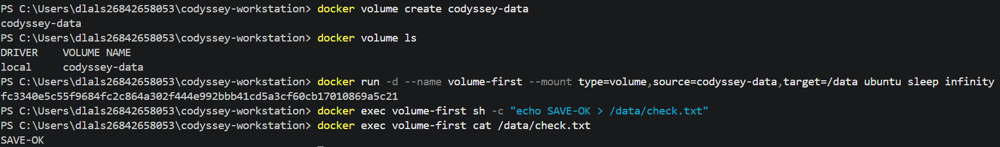

### 추가 검증 — 컨테이너 삭제 후 데이터 재확인 (2026-11-04)

다시 실행한 명령에서 기존 `volume-first` 컨테이너가 목록에 없음을 확인했다.

```powershell
docker ps -a --filter "name=volume-first"
```

이어서 **새로운 일회용 컨테이너**에 이전에 사용한 `codyssey-data` 볼륨을 연결하여 파일을 읽었다.

```powershell
docker run --rm --mount type=volume,source=codyssey-data,target=/data ubuntu cat /data/check.txt
```

**실제 화면의 출력:**

```text
SAVE-OK
```

기존 컨테이너는 사라졌지만 파일 내용이 남아 있으므로 **Docker 볼륨의 데이터 유지(영속성)가 확인됐다.**

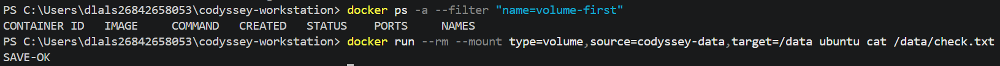


[볼륨 실습 로그 — 삭제 후 SAVE-OK 출력 포함](logs/verified/08-volume.txt)

## 10. 트러블슈팅 2건

두 오류는 **실수를 재현하고 해결 방법을 확인한 실습**으로 정리했다.

### 10-1. 컨테이너 이름 오타

```powershell
docker logs codyssey-weeb
# 실제 오류: No such container: codyssey-weeb
docker ps -a
docker logs codyssey-web
```

잘못된 이름을 사용해 로그를 불러오지 못했고, 실제 컨테이너 이름을 확인한 뒤 다시 실행해 해결했다.

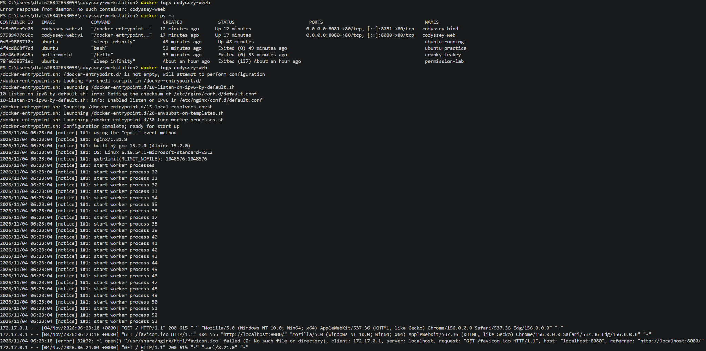

### 10-2. 파일 경로 오타

```powershell
docker exec codyssey-web ls /usr/nginx/html
# 실제 오류: No such file or directory
docker exec codyssey-web ls /usr/share/nginx/html
docker exec codyssey-web cat /usr/share/nginx/html/index.html
```

**`/usr/share/nginx/html`에서 `share`를 빠뜨린 실수**였다. 올바른 경로를 확인하자 `index.html`이 보였고 HTML을 읽는 데 성공했다.

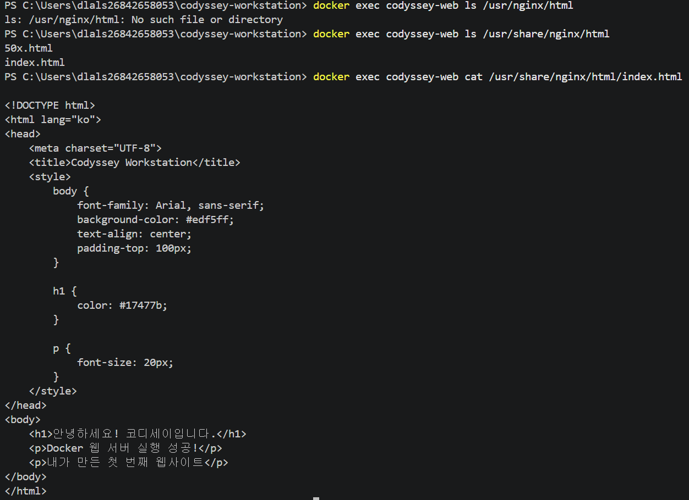

[트러블슈팅 상세 보고서](logs/troubleshooting.md) · [실제 오류 기록](logs/verified/09-troubleshooting.txt)

## 11. Git과 GitHub 저장소 연결

### Git 설치 버전 확인 

```powershell
git --version
```

**실제 출력:**

```text
git version 2.56.0.windows.4
```

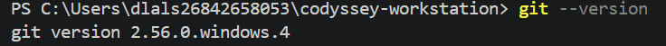

Git 버전은 새로 제공한 **터미널 화면 캡처**로 확인했다.

### Git 저장소와 GitHub 원격 주소

```powershell
git init -b main
git status
git branch --show-current
git remote add origin https://github.com/hyeonla906/codyssey-workstation.git
git remote -v
```

### 1. Git 커밋 기록 확인

다음 명령어를 사용하여 가장 최근 커밋 기록을 확인하였다.

`git log -1 --oneline`

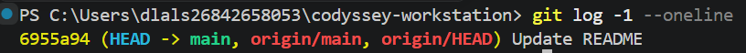


### 2. Git Push 실행 결과

git push origin main 명령어를 실행하여
GitHub 원격 저장소의 동기화 상태를 확인하였다.

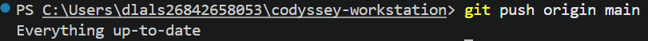

### 3. GitHub 파일 목록 확인

GitHub 저장소의 Code 화면에서
README.md, Dockerfile, app, logs, screenshots 등의
파일과 폴더가 업로드되어 있는 것을 확인하였다.

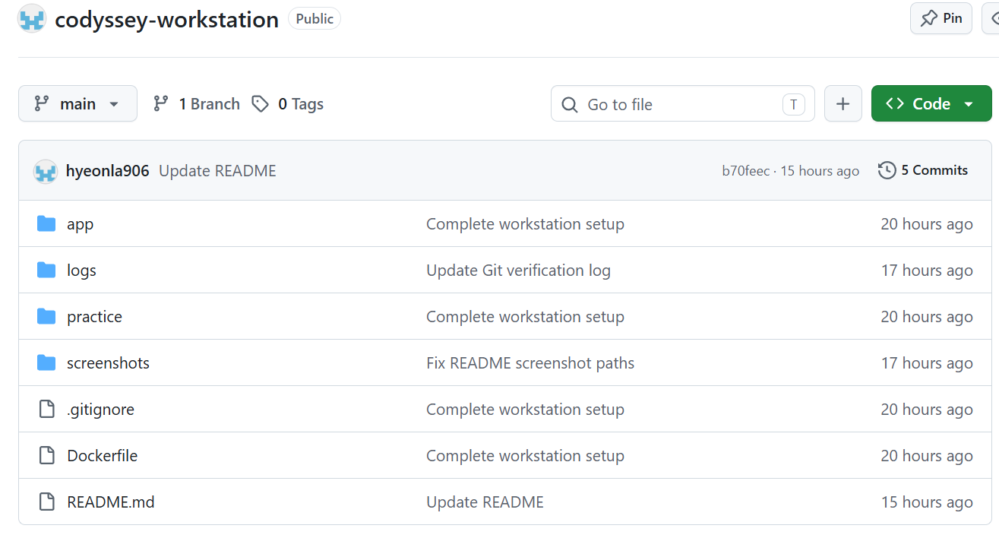


- 로컬 Git 저장소가 존재했고, 현재 브랜치가 **`main`**이었다.
- `git remote -v` 출력에서 GitHub 원격 저장소 주소가 등록된 것을 확인했다.
- 실제 `git push` 성공파일을 업로드 한사진과 연동하였다.
- `git --version`은 위 사진에서 확인됐다.  커밋 기록(`git log -1 --oneline`)과 `git push` 성공 출력 및 업로드된 파일 목록 확인함

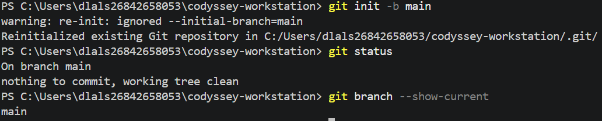

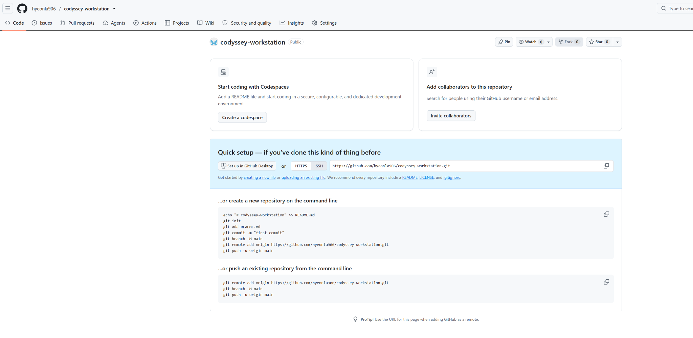

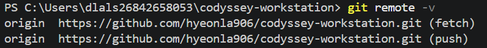

[GitHub 연결 로그](logs/verified/11-github-setup.txt)

### 로컬 Git 상태 관련 메모

최근 터미널 대화에서 `git restore -- .`를 실행한 뒤 `deleted:` 항목이 사라지고 `a/` 폴더 및 `02-permissions-recheck.txt`, `08-volume-recheck.txt`, `10-git-recheck.txt`가 **추적되지 않은 파일**로 남았다. 이는 업로드 실패를 의미하지는 않지만, **GitHub에 반영됐다는 증거도 아니다.** 또한 복구 후 로컬 `README.md`의 크기가 0바이트로 확인되었으므로, 아래의 새 README를 적용하고 사진 폴더를 복사한 다음 다시 Git 상태를 확인해야 한다. 이 내용은 사용자 제공 터미널 결과를 근거로 작성했다.


## 12. 다른 컴퓨터에서 웹 서버 실행하기

Docker Desktop을 Linux 컨테이너 모드로 켠 뒤 PowerShell에서 실행한다.

```powershell
git clone https://github.com/hyeonla906/codyssey-workstation.git
cd codyssey-workstation
docker build -t codyssey-web:v1 .
docker run -d --name codyssey-web -p 8080:80 codyssey-web:v1
curl.exe http://localhost:8080
```

브라우저 접속: `http://localhost:8080`  


## 13. 배운 점

- **절대 경로:** 파일의 전체 주소.
- **상대 경로:** 지금 있는 폴더를 기준으로 쓴 주소.
- **Linux 권한:** `r=읽기`, `w=쓰기`, `x=실행 또는 폴더 진입`.
- **Docker 이미지:** 실행 준비가 된 묶음.
- **Docker 컨테이너:** 이미지를 실제 실행한 공간.
- **포트 연결:** 내 컴퓨터 8080번을 컨테이너 80번에 연결하는 것.
- **바인드 마운트:** 내 컴퓨터 파일을 컨테이너 안에서 함께 사용하는 것.
- **Docker 볼륨:** 컨테이너와 별도로 데이터를 저장하는 공간.
- **Git / GitHub:** 파일의 변경 기록 관리 / 그 기록을 인터넷에서 보관·공유.

## 14. 제출 전 직접 채워야 할 것

- [x] Linux 폴더 `755` 최종 출력이 보이는 사진 및 검증 결과 추가 완료
- [x] 컨테이너 삭제 **후** `SAVE-OK` 출력 화면 사진까지 확인
- [x] `git --version` 실제 출력 사진 확인 — `2.56.0.windows.4`
- [ ] **[추가 필요]** `git push` 성공 확인
- [ ] **[추가 필요]** GitHub에서 실제 파일이 보이는 최종 저장소 사진
- [ ] **[추가 필요]** 공개 전 PowerShell 기록 및 사진의 사용자 이름, 컴퓨터 이름, 경로 등 개인정보 확인
- [ ] **[추가 필요]** GitHub에 `README.md`, `Dockerfile`, `app/index.html`, `logs/`, `screenshots/`가 올라왔는지 검

## 15. 최종 정리

**확인된 작업:** 파일 관리, Linux 파일 권한 `600`·`644`와 폴더 권한 `700`·`755` 검증, Docker 29.9.2 실행, Ubuntu/hello-world, NGINX 이미지 빌드, 8080 웹 접속, 8081 바인드 마운트 변경 전·후, 컨테이너 삭제 후 볼륨 데이터 유지(원본 로그와 재검증 사진), 트러블슈팅 2건, Git `main` 및 GitHub 원격 주소 설정.

**아직 제출 완료로 판단하지 않은 항목:** 최종 GitHub 업로드(`git push`) 성공 증거와 실제 파일 목록. Git 버전은 **2.56.0.windows.4**로 확인했다. GitHub 공개 전 개인정보 확인도 필요하다.
