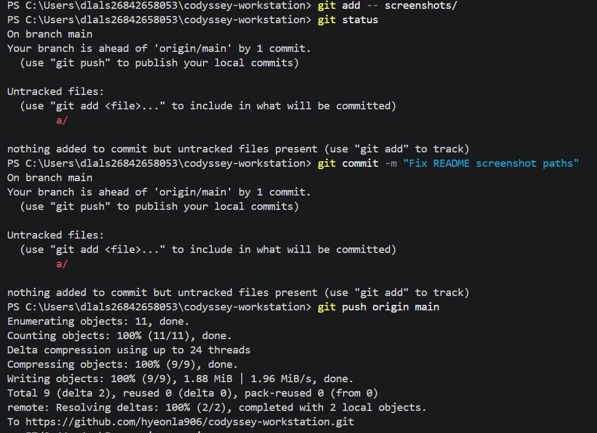
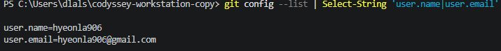

# Codyssey Development Workstation

Windows PowerShell 기반 CLI·Linux 권한·Docker·Git/GitHub 실습 기록.

## 1. 실습 결과

| 항목 | 확인 결과 | 관련 위치 |
|---|---|---|
| CLI | 파일 생성·복사·이동·삭제, 내용 출력 | [CLI](#3-cli-파일-관리) |
| Linux 권한 | 파일 `600`·`644`, 폴더 `700`·`755` | [권한](#4-linux-권한) |
| Docker | Linux 엔진, 이미지·컨테이너 목록, `hello-world` | [Docker](#5-docker-기본-점검) |
| 웹 서버 | `codyssey-web:v1` 빌드, `localhost:8080` 접속 | [웹 서버](#6-dockerfile--웹-서버) |
| 바인드 마운트 | HTML 변경 전·후 화면 비교 (`8081`) | [바인드 마운트](#7-바인드-마운트) |
| 볼륨 | 컨테이너 삭제 후 `SAVE-OK` 재확인 | [볼륨](#8-볼륨-데이터-유지) |
| Git/GitHub | `main`, `origin` 확인, `git push` 실행 | [Git](#9-gitgithub) |
| 오류 해결 | 컨테이너 이름·NGINX 파일 경로 오류 2건 | [오류 해결](#10-오류-해결) |

### 실행 환경

| 항목 | 환경 |
|---|---|
| OS / 터미널 | Windows / PowerShell 5.1 |
| 편집기 | VS Code |
| Docker | 29.9.2 / Linux 컨테이너 |
| Git | 2.56.0.windows.4 / `main` |
| 웹 서버 | `nginx:alpine` 기반 커스텀 이미지 |

### 폴더 구성

```text
Dockerfile                이미지 빌드 설정
app/index.html            웹페이지
practice/                 CLI 실습 파일
logs/verified/            터미널 실행 로그
logs/troubleshooting.md   오류 해결 과정
screenshots/              실습 사진
README.md                 실행 방법·확인 결과
```

**구성:** 웹 파일(`app`), 이미지 설정(`Dockerfile`), 로그(`logs`), 사진(`screenshots`) 분리.

## 2. 실행 방법

**환경:** Docker Desktop(Linux 엔진), PowerShell.

```powershell
git clone https://github.com/hyeonla906/codyssey-workstation.git
cd codyssey-workstation
docker build -t codyssey-web:v1 .
docker run -d --name codyssey-web -p 8080:80 codyssey-web:v1
curl.exe http://localhost:8080
```

**결과 확인:** `http://localhost:8080` 웹페이지 표시.

**중복 확인:** 컨테이너 이름 충돌 시 `docker ps -a`로 조회 후 이름 변경. 포트 충돌 시 호스트 포트 변경.

### 연결 정보

| 항목 | 연결 | 용도 |
|---|---|---|
| 웹 서버 | PC `8080` → 컨테이너 `80` | 기본 웹페이지 |
| 바인드 마운트 | PC `8081` → 컨테이너 `80` | 파일 변경 반영 |
| 폴더 연결 | PC `app` → `/usr/share/nginx/html` | HTML 공유 |
| Docker 볼륨 | `codyssey-data` → `/data` | 컨테이너 삭제 후 파일 보관 |

**포트 연결:** 컨테이너는 별도 네트워크 네임스페이스 사용. `-p 8080:80` → PC `8080`에서 컨테이너 `80`으로 연결. `EXPOSE 80`은 포트 공개 설정이 아님.

## 3. CLI 파일 관리

**실습:** 파일 생성·조회·복사·이동·삭제.

```powershell
pwd
Get-ChildItem -Force
mkdir practice\lesson1
cd practice\lesson1
New-Item empty.txt -ItemType File
"Hello Codyssey" | Set-Content hello.txt
Get-Content hello.txt
Copy-Item hello.txt copy.txt
Rename-Item copy.txt renamed.txt
mkdir backup
Move-Item renamed.txt backup
Get-ChildItem backup
Remove-Item backup\renamed.txt
Get-ChildItem backup
cd ..\..
```

**결과:** `Get-Content hello.txt` → `Hello Codyssey`. 복사·이동·삭제 후 파일 목록 확인.


[실행 로그](logs/verified/01-terminal.txt)

## 4. Linux 권한

**실습:** Ubuntu 컨테이너에서 파일·폴더 권한 변경 및 조회.

```powershell
docker run -d --name permission-lab ubuntu sleep infinity
docker exec permission-lab touch /test.txt
docker exec permission-lab chmod 600 /test.txt
docker exec permission-lab ls -l /test.txt
docker exec permission-lab chmod 644 /test.txt
docker exec permission-lab ls -l /test.txt
docker exec permission-lab mkdir /testdir
docker exec permission-lab chmod 700 /testdir
docker exec permission-lab ls -ld /testdir
docker exec permission-lab chmod 755 /testdir
docker exec permission-lab ls -ld /testdir
```

| 권한 | 소유자 | 그룹 | 기타 사용자 | 표시 |
|---|---|---|---|---|
| `600` | 읽기·쓰기 | 없음 | 없음 | `-rw-------` |
| `644` | 읽기·쓰기 | 읽기 | 읽기 | `-rw-r--r--` |
| `700` | 읽기·쓰기·실행 | 없음 | 없음 | `drwx------` |
| `755` | 읽기·쓰기·실행 | 읽기·실행 | 읽기·실행 | `drwxr-xr-x` |

**권한 계산:** `r=4`, `w=2`, `x=1` → `755 = rwx / r-x / r-x`. 폴더의 `x`는 진입 권한.

**결과:** `ls -ld /testdir` → `drwxr-xr-x` (`755`).


[권한 실행 로그](logs/verified/02-permissions.txt)

## 5. Docker 기본 점검

### 5-1. 엔진 상태

```powershell
docker --version
docker info
```

**실행 결과:**

```text
Docker version 29.9.2, build a82e528
Server Version: 29.9.2
OSType: linux
```

**확인:** Docker Linux 엔진 실행.


[Docker 실행 기록](logs/verified/03-docker.txt) · 상세 출력은 위 사진.

### 5-2. 이미지·컨테이너

```powershell
docker pull ubuntu
docker run hello-world
docker run -it --name ubuntu-practice ubuntu bash
docker images
docker ps
docker ps -a
docker run -d --name ubuntu-running ubuntu sleep infinity
docker exec ubuntu-running echo Hello-from-exec
docker stop ubuntu-running
docker start ubuntu-running
```

**실행 결과:** `hello-world` → `Hello from Docker!`. `docker images` 출력 일부:

```text
hello-world:latest
ubuntu:latest
```

**컨테이너 확인:** `docker ps -a` → 실행·중지된 컨테이너 목록.

**이미지·컨테이너:** 이미지 = 실행 환경 저장본, 컨테이너 = 이미지의 실행 인스턴스. `docker build` = 이미지 생성, `docker run` = 컨테이너 실행.


[컨테이너 실행 로그](logs/verified/04-containers.txt) · 이미지·컨테이너 목록은 위 사진.

## 6. Dockerfile · 웹 서버

**Dockerfile**

```dockerfile
FROM nginx:alpine
COPY app/index.html /usr/share/nginx/html/index.html
EXPOSE 80
```

- `FROM`: 기본 이미지 선택
- `COPY`: HTML 파일을 이미지에 복사
- `EXPOSE`: 컨테이너 내부 포트 표시

**빌드·실행**

```powershell
docker build -t codyssey-web:v1 .
docker images
docker run -d --name codyssey-web -p 8080:80 codyssey-web:v1
docker ps
docker logs codyssey-web
curl.exe http://localhost:8080
```

**빌드 결과:** `naming to docker.io/library/codyssey-web:v1` → `unpacking to docker.io/library/codyssey-web:v1`.

**접속 결과:** `localhost:8080` → HTML 응답, NGINX `GET /` → HTTP `200`.


[웹 서버 빌드·실행 로그](logs/verified/06-webserver.txt)

## 7. 바인드 마운트

**실습:** PC `app` 폴더 ↔ 컨테이너 NGINX 웹 폴더 연결. HTML 변경 전·후 비교.

```powershell
$appPath = (Resolve-Path .\app).Path
docker run -d --name codyssey-bind -p 8081:80 --mount "type=bind,source=$appPath,target=/usr/share/nginx/html,readonly" codyssey-web:v1
curl.exe http://localhost:8081
docker inspect codyssey-bind --format '{{json .Mounts}}'
```

**결과:** `localhost:8081`에 HTML 변경 반영. `readonly` → 컨테이너 내부 쓰기 제한.

**경로:** `app/index.html` = 프로젝트 기준 상대경로. `$appPath` = `Resolve-Path`로 확인한 PC 절대경로. `/usr/share/nginx/html` = 컨테이너 내부 절대경로.


[바인드 마운트 로그](logs/verified/07-bind.txt) · 사진과 로그는 촬영 시점이 다름.

## 8. 볼륨 데이터 유지

```powershell
docker volume create codyssey-data
docker volume ls
docker run -d --name volume-first --mount type=volume,source=codyssey-data,target=/data ubuntu sleep infinity
docker exec volume-first sh -c "echo SAVE-OK > /data/check.txt"
docker exec volume-first cat /data/check.txt
docker stop volume-first
docker rm volume-first
docker run --rm --mount type=volume,source=codyssey-data,target=/data ubuntu cat /data/check.txt
docker volume inspect codyssey-data
```

**결과:** `volume-first` 삭제 후 새 컨테이너에서 `SAVE-OK` 출력. 데이터 유지 확인.

**볼륨 정보:** `codyssey-data` / `local` / `/var/lib/docker/volumes/codyssey-data/_data` (`docker volume inspect`).

| 방식 | 장점 | 주의 사항 |
|---|---|---|
| 바인드 마운트 | PC 파일 변경을 컨테이너에서 즉시 확인 | PC 폴더 경로에 영향받음 |
| Docker 볼륨 | 컨테이너 삭제 후에도 데이터 보관 | PC에서 파일을 직접 수정하기는 불편 |


[볼륨 실습 로그](logs/verified/08-volume.txt)

## 9. Git/GitHub

```powershell
git --version
git status
git remote -v
git log -1 --oneline
git push origin main
```

**결과:** Git `2.56.0.windows.4`, `main` 브랜치, `origin` 연결, `git push origin main` 실행.

```text
origin  https://github.com/hyeonla906/codyssey-workstation.git (fetch)
origin  https://github.com/hyeonla906/codyssey-workstation.git (push)
```

**Git 작업:** `status` → `add` → `commit` → `push`. `commit` = 로컬 기록, `push` = GitHub 반영.




**원격 저장소 확인:** `git remote -v` 출력 사진.

### Git 사용자 설정 확인

```powershell
git config --list | Select-String '^(user\.name|user\.email)='
```

**설정 확인:** 'user.name'=hyeonla906 'user.email'=hyeonla906@gmail.com 출력. 



## 10. 오류 해결

| 발생 | 원인 가설 | 확인 | 조치·결과 |
|---|---|---|---|
| `No such container: codyssey-weeb` | 컨테이너 삭제 또는 이름 오타 | `docker ps -a`로 실제 이름 `codyssey-web` 확인 | `docker logs codyssey-web` → NGINX 로그 확인 |
| `No such file or directory` | NGINX 내부 폴더 경로 오타 | `/usr/share/nginx/html` 확인 | `docker exec codyssey-web cat /usr/share/nginx/html/index.html` → HTML 출력 |


[오류 해결 기록](logs/troubleshooting.md) · [실행 로그](logs/verified/09-troubleshooting.txt)

## 11. 포트 접속 문제 확인

**접속 점검:** 컨테이너 상태 → HTTP 응답 → 포트 사용 현황.

```powershell
docker ps
curl.exe http://localhost:8080
Get-NetTCPConnection -LocalPort 8080 -State Listen -ErrorAction SilentlyContinue
```

- `docker ps`: 컨테이너 상태·포트 확인 (`8080→80`)
- `curl.exe`: HTTP 응답 확인
- `Get-NetTCPConnection`: 포트 `8080`의 프로세스 ID(`OwningProcess`) 확인
- 포트 충돌 확인: `Get-Process -Id 1234` (`1234` = 조회된 PID)
- 충돌 해결: 기존 컨테이너 중지 또는 호스트 포트 변경

**대체 포트 예시 (미실행):**

```powershell
docker run -d --name codyssey-web-alt -p 8082:80 codyssey-web:v1
```
